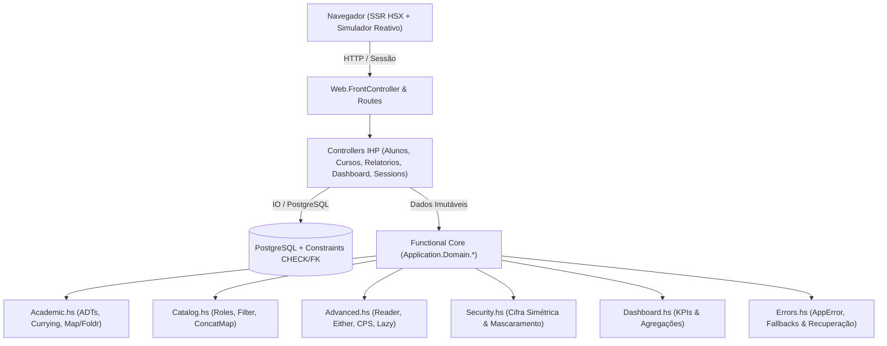

# Arquitetura e Decisões Técnicas (ADRs) — SGA-Func

Este documento consolida a arquitetura do **SGA-Func (Sistema de Gestão Acadêmica Funcional)** e registra as principais decisões de engenharia tomadas ao longo das Sprints 0 a 5.

---

## 1. Visão Geral da Arquitetura (*Functional Core / Imperative Shell*)

O sistema foi desenhado separando rigorosamente as regras de negócio puras (sem efeitos colaterais) da camada web e de persistência (que lida com `IO`, HTTP e PostgreSQL):

### Princípios Estruturais
1. **Imutabilidade por padrão**: Todas as transformações de notas, frequências, rankings e filtros operam sobre listas e registros imutáveis.
2. **Efeitos colaterais confinados**: Apenas os `Controllers` e `Scripts` realizam `IO`. O domínio puro é 100% determinístico e testável sem banco de dados.
3. **Integridade em duas camadas**: Regras de validação existem tanto em Haskell (feedback imediato no formulário) quanto no PostgreSQL (`CHECK`, `UNIQUE`, `ON DELETE RESTRICT`).

---

## 2. Registro de Decisões Arquiteturais (ADRs)

### ADR-001: Uso do IHP + HSX (SSR) em vez de Miso/Obelisk
* **Contexto**: A disciplina permite stacks Haskell Web (IHP, Yesod, Servant, Miso/Obelisk).
* **Decisão**: Adotar o framework **IHP** com templates **HSX** renderizados no servidor (SSR) e PostgreSQL tipado.
* **Consequências**:
  * *Positivas*: Produtividade alta com scaffolding tipado, migrations versionadas, autenticação nativa robusta e compilação estática de HTML sem risco de XSS.
  * *Trade-off*: Não utiliza SPA em GHCJS/Miso; a reatividade é atendida pelo **Simulador Reativo** no cliente aliado ao *Turbolinks/Morphdom* nativo do IHP.

### ADR-002: Separação em *Functional Core / Imperative Shell*
* **Contexto**: Misturar queries SQL com cálculos de média, frequência e validação dificulta testes e acopla regras acadêmicas ao framework web.
* **Decisão**: Isolar toda a lógica de domínio em módulos puros sob `Application/Domain/` (`Academic`, `Catalog`, `Advanced`, `Security`, `Dashboard`, `Errors`).
* **Consequências**: Testes unitários (`HSpec`) rodam em milissegundos sem precisar subir PostgreSQL, enquanto [`Test/Integration.hs`](../Test/Integration.hs) valida a integração HTTP + SQL.

### ADR-003: Validação Dupla (Haskell + PostgreSQL Constraints)
* **Contexto**: Validações apenas no frontend ou apenas no controller podem ser contornadas por inserções diretas ou concorrência.
* **Decisão**: Manter validadores puros em `Catalog.hs`/`Errors.hs` e replicar invariantes críticas no banco (`CHECK` de carga horária, regex de matrícula/código/e-mail, `ON DELETE RESTRICT` para proteger histórico de notas e frequências).
* **Consequências**: Garantia forte de consistência dos dados mesmo sob carga concorrente.

### ADR-004: Tratamento de Erros Monádico com `AppError` e Recuperação Graciosa
* **Contexto**: Buscas diretas (`fetch`) lançam exceções em UUIDs inexistentes e falhas de decifragem ou listas vazias poderiam quebrar a renderização.
* **Decisão**: Criar o ADT `AppError` e combinadores (`note`, `recoverWith`, `withFallback`, `decifrarOuFallback`, `calcularMediaSegura`) em [`Application/Domain/Errors.hs`](../Application/Domain/Errors.hs), além de blindar [`RelatoriosController`](../Web/Controller/Relatorios.hs) com `findTurmaOr404`.
* **Consequências**: Rotas inválidas retornam `404` controlado e o domínio nunca propaga exceções não tratadas por divisão por zero ou dados corrompidos.

### ADR-005: Criptografia Simétrica Pura para Campos Confidenciais
* **Contexto**: Necessidade de proteger documentos sensíveis (CPF/RG) no banco sem adicionar dependências C nativas que quebrem o build Nix/Cabal.
* **Decisão**: Implementar keystream cipher reversível com codificação hexadecimal em [`Application/Domain/Security.hs`](../Application/Domain/Security.hs), expondo texto claro apenas para `admin` e mascaramento automático para `consulta`.
* **Consequências**: Portabilidade total em Nix/GHC e controle de acesso por perfil aplicado diretamente na camada de visualização e domínio.

### ADR-006: Teste de Stress Nativo em Haskell (`StressTest.hs`)
* **Contexto**: Validar comportamento sob carga sem depender de ferramentas externas ausentes no ambiente (`wrk`).
* **Decisão**: Implementar [`Application/Script/StressTest.hs`](../Application/Script/StressTest.hs) usando `forkIO`, `MVar` e `Data.Time.Clock` para estressar o núcleo puro (50.000 notas), pipelines criptográficos concorrentes e queries concorrentes ao PostgreSQL.
* **Consequências**: Benchmark reproduzível dentro do próprio ecossistema Haskell/IHP.
